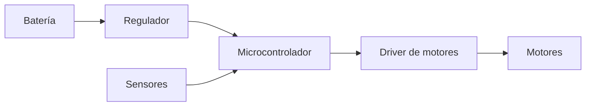

# {{NOMBRE}}

| | |
|---|---|
| **Estado** | En desarrollo |
| **Inicio** | {{FECHA}} |
| **Fin** | — |
| **Tipo** | Sumo / Seguidor de línea / Brazo / Autónomo / Otro |
| **Competencia** | — |
| **Integrantes** | Nombre (rol), Nombre (rol) |
| **Asesor** | — |

## Objetivo

¿Qué problema resuelve o para qué competencia es? Una o dos líneas.

## Resumen

Descripción general del robot: cómo funciona, qué lo hace diferente.

## Especificaciones

| Característica | Valor |
|---|---|
| Microcontrolador | ej. ESP32 / Teensy 4.1 / Arduino Nano |
| Motores | |
| Driver de motores | |
| Sensores | |
| Alimentación | ej. LiPo 3S 1300 mAh |
| Dimensiones / peso | |
| Material del chasis | |
| Costo aproximado | $ MXN (ver [bom.csv](bom.csv)) |

## Arquitectura

Diagrama de bloques (GitHub dibuja Mermaid automáticamente, edítalo a tu gusto):

Diagrama de conexiones completo: [electronica/](electronica/)

## Cómo reproducirlo

1. Imprimir / fabricar piezas de [cad/](cad/) — material, relleno, orientación recomendada.
2. Armar electrónica según [electronica/](electronica/).
3. Compilar y cargar firmware según [firmware/](firmware/).
4. Calibración: qué hay que ajustar y cómo.

## Resultados

¿Cómo le fue? Lugar en competencia, pruebas, números (velocidad, tiempos, etc.).

## Lecciones aprendidas

> **La sección más importante.** Escribe lo que te hubiera gustado saber antes de empezar.

- **Lo que funcionó bien:**
- **Lo que falló y por qué:**
- **Lo que haríamos diferente:**
- **Trampas a evitar** (piezas que se rompen, componentes que no sirven, errores de diseño):

## Siguientes pasos

Ideas para quien retome o mejore este proyecto.

## Referencias

Tutoriales, datasheets, repos o videos que sirvieron.
